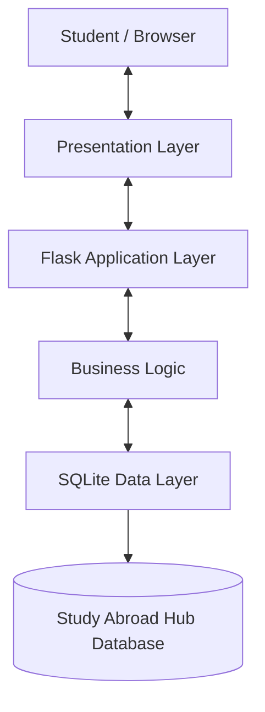

# System Architecture

## 1. Architecture Style

Study Abroad Hub follows a simple three-layer architecture.
The system is implemented as a Flask-based web application
using SQLite for data storage.

## 2. Layers

### Presentation Layer
- Provides the user interface.
- Displays universities and study programs.
- Contains search, filter, eligibility and comparison forms.
- Uses HTML, CSS, Bootstrap and Jinja templates.

### Application Layer
- Handles incoming requests through Flask routes.
- Processes search and filter operations.
- Executes eligibility-checking rules.
- Manages shortlists and program comparisons.
- Communicates with the database layer.

### Data Layer
- Uses SQLite as the relational database.
- Stores university and program information.
- Stores shortlist and shortlist-item records.
- Provides data to the application layer.

## 3. Request Flow

1. A student interacts with a web page.
2. The browser sends a request to the Flask application.
3. Flask processes the request and invokes the required logic.
4. The application accesses SQLite when data is needed.
5. SQLite returns the requested data.
6. Flask sends the result to the browser for display.

## 4. Architecture Diagram

## 5. Design Decision

A three-layer architecture is suitable because it separates
the user interface, application logic and data storage.
This makes the application easier to understand, test,
maintain and extend.
