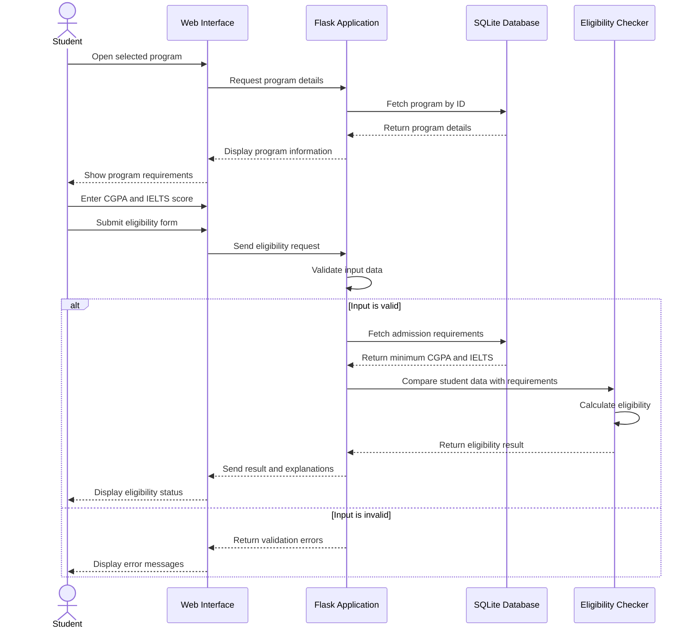

# Eligibility Checking — Sequence Diagram

## Description

This sequence diagram illustrates the interaction between the student, web interface, Flask application, SQLite database, and eligibility checking module when a student checks eligibility for a selected study program.

## Diagram

## Explanation

1. The student opens a selected study program.
2. The web interface requests program information from Flask.
3. Flask retrieves the program details from SQLite.
4. The student enters academic information such as CGPA and IELTS score.
5. The backend validates the submitted information.
6. The backend retrieves the admission requirements.
7. The eligibility checker compares the student's details with the requirements.
8. The system returns the eligibility result and displays it to the student.
9. If the input is invalid, the system displays validation errors.

## Purpose

The diagram describes the sequence of interactions required to perform eligibility checking in Study Abroad Hub.
