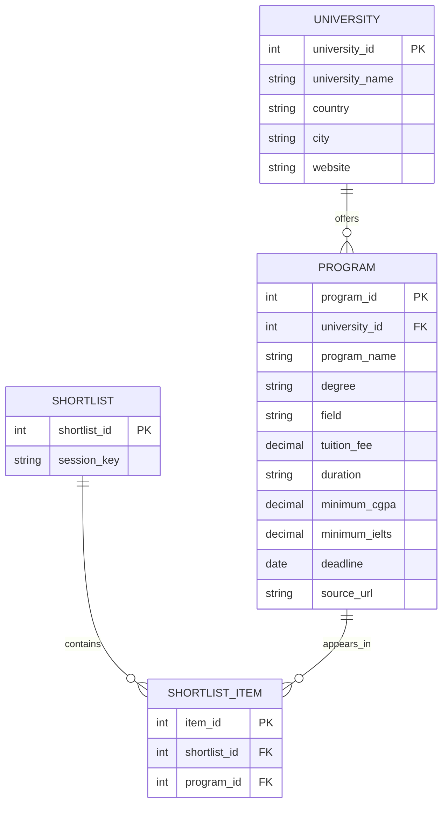

# Entity Relationship Diagram — Study Abroad Hub

## Description

The ER diagram represents the database structure of Study Abroad Hub. It shows the entities, their attributes, primary keys, foreign keys and relationships.

## ER Diagram



## Explanation of Entities

### 1. University

Stores information about universities available in the system.

- university_id: Primary key.
- university_name: Name of the university.
- country: Country where it is located.
- city: University city.
- website: Official website.

### 2. Program

Stores information about academic programs offered by universities.

- program_id: Primary key.
- university_id: Foreign key referencing University.
- program_name: Name of the program.
- degree: Degree offered.
- field: Academic field.
- tuition_fee: Tuition amount.
- duration: Program duration.
- minimum_cgpa: Minimum CGPA requirement.
- minimum_ielts: Minimum IELTS requirement.
- deadline: Application deadline.
- source_url: Source of program information.

### 3. Shortlist

Stores a shortlist associated with a browser session.

- shortlist_id: Primary key.
- session_key: Unique identifier for the browser session.

### 4. Shortlist Item

Stores individual programs saved by a student.

- item_id: Primary key.
- shortlist_id: Foreign key referencing Shortlist.
- program_id: Foreign key referencing Program.

## Relationships

1. University and Program: One-to-Many. One university can offer multiple programs.
2. Shortlist and Shortlist Item: One-to-Many. One shortlist can contain multiple items.
3. Program and Shortlist Item: One-to-Many. A program can appear in multiple shortlists.

## Keys

- Primary Key (PK): Uniquely identifies a record in a table.
- Foreign Key (FK): References a primary key in another table and establishes a relationship.

## Purpose

The ER diagram helps us design a structured relational database and understand how information is connected within Study Abroad Hub.
```
