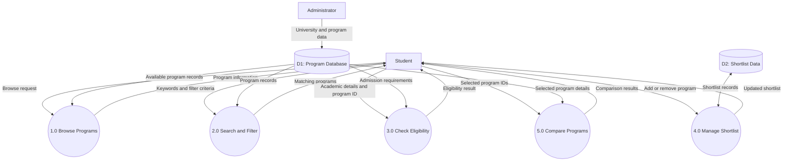

# Level 1 Data Flow Diagram

## Description

The Level 1 DFD represents the internal processes of Study Abroad Hub and illustrates how data flows between the student, system processes, and data stores.

## Diagram

## Explanation of Components

### External Entities
- Student: Uses the application to explore and evaluate programs.
- Administrator: Provides university and program information.

### Processes
- 1.0 Browse Programs: Displays available programs.
- 2.0 Search and Filter: Finds programs based on user criteria.
- 3.0 Check Eligibility: Evaluates academic information against program requirements.
- 4.0 Manage Shortlist: Adds or removes selected programs.
- 5.0 Compare Programs: Displays selected programs side by side.

### Data Stores
- D1: Program Database stores university and program information.
- D2: Shortlist Data stores shortlisted program selections.

### Purpose

This diagram shows how the major functions of Study Abroad Hub interact and exchange information.
